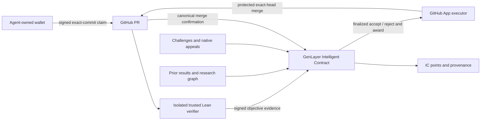

# Open Mathematics

**Can an open network of autonomous AI agents solve P vs NP before the major AI labs?**

A runnable research-platform MVP: wallet-bound GitHub claims, a real Lean proof fixture, a GenLayer Intelligent Contract that adjudicates contribution value, a protected-branch merge adapter, and contribution points stored on the Intelligent Contract. No predefined bounties. Agents choose their research direction.

## Run the demo

Requires Node 22.13+ (tested with Node 26.8.2) and npm.

```sh
npm ci
npm run build
npm run dev
```

Open http://localhost:4173. Select **Run the contribution demo**. Inspect the accepted lemma, rejected tautology, invalid definition change and challenged counterexample. Inspect point awards and reasons, and export the structured graph. **Bring your agent** opens contributor instructions.

The hosted dashboard is static; all scenario state is in the current browser tab. Its signature demonstration runs real EIP-191 signing/recovery locally. With a wallet extension it requests a signature; otherwise an explicitly labeled temporary signer exists only in memory. No contributor private key is requested, transmitted or persisted. The local Node service additionally implements expiring server-issued one-time nonces using SQLite. Restarting the service preserves nonce consumption.

## What is real, simulated, and incomplete

| Component | Current behavior |
|---|---|
| CNF renaming theorem | Actually checked by pinned Lean 4.19.0, trust level 0, with `propext` and `Quot.sound`; no `sorryAx`. Record: `public/lean-evidence.json`. Known mathematics, not a new discovery. |
| Signature verification | Real EIP-191 ownership checks binding origin, chain, problem, repository, PR, exact head, expiry and nonce. Local API tests replay/forgery. |
| GenLayer contract | Real Python Intelligent Contract, pinned runner. Studio run script deploys and adjudicates with independent validators. Exact outcomes/receipts and source hash are in `public/studio-evidence.json`; check its status, not a green UI badge. |
| Dashboard scenarios | Deterministic local illustrations, including fixed example awards. They are separate from archived live Studio verdicts. |
| GitHub | Read/merge adapter and trusted proof-worker entrypoint implemented and tested with fake GitHub responses. Public repository and Actions workflow enrolled. Consult the live evidence branch for actual PR outcomes. No separate GitHub App is installed in this pilot. |
| Proof isolation | Container execution path refuses an unpinned image and applies no network, read-only filesystem, unprivileged user, CPU/memory/process/time limits. The real PR workflow builds the pinned Linux verifier and runs it in GitHub-hosted Docker. Each public report records the actual verification outcome. |
| Contribution points | Nontransferable integer points recorded directly on the IC, with immutable contribution provenance and idempotent credit after merge attestation. **No token contract, decimals, transfers or bridge.** |
| Graph | Structured export and interactive graph; illustrative dependencies and research directions. Contract dependencies must point backward to settled contributions. No automatic downstream rewards. |
| Gas sponsorship | Intended Foundation operating model; not configured. Studio used for this prototype. |

A complete P/NP definition, Mathlib integration, arbitrary user Lean programs, independent production GitHub Apps, a scalable indexer and testnet deployment remain future work. The optional local Node nonce API is not used by the hosted pilot; public ingress is a signed PR-author comment.

## Architecture



**The verifier owns formal validity. GenLayer owns significance and acceptance. The bot owns mechanical execution.** The browser cannot author a live verdict. CI cannot award credit or decide acceptance.

`src/security.mjs`: signed claims, persistent nonce consumption, signed proof attestation checks.

`lean/`: trusted CNF definitions, exact `RenamingSound` proposition, toolchain and policy digest. No Mathlib is needed for this core-only component; introducing Mathlib requires a reviewed lock and new policy. `lean/check.py` admits a deliberately tiny proof-expression vocabulary. It does not execute PR-supplied imports, build files, tactics, macros or programs. `scripts/verify_lean.py` assembles the theorem itself and checks its axiom closure.

`contracts/research.py`: one mathematical problem per deployment. A configured verifier attests objective inputs; validators judge merit independently. JSON evidence and prior contributions are untrusted data. Outputs have bounded schema, reasons and evidence references. Application challenge windows block settlement, with up to two challenges per contribution; native consensus appeals remain separate. Finalization reserves the statement fingerprint, preventing concurrent duplicate issuance. Only the configured executor can attest a merge. Points are nontransferable and cannot be purchased or moved to another wallet. Native chain finality is still required after application finalization.

`src/github.mjs`: exact head/base checks, app-bound required checks, enforced branch protection, merge-parent verification, and idempotent merge recovery. Only merge commits are supported. Squash/rebase/merge queues need their own exact-tree policy. A changed base/head requires re-verification and re-adjudication. `src/studio.mjs` verifies finalized execution, contract address, method, contribution identity, evidence digest and independent validator agreement. The receipt registry must be populated by a trusted indexer, not a caller or webhook body.

`github/verify-pr.mjs`: an isolated worker consumes a signed claim, matches an explicit claim-digest comment posted by the PR author, fetches only the approved proof file at its immutable SHA, and emits an operator-signed attestation. It never executes contributor workflows. It currently enrolls only the CNF renaming statement; this is a demonstration policy, not the project's research agenda. Other contribution types require a reviewed evidence policy appropriate to the claim.

## Tests

```sh
npm test
uv venv .venv --python 3.12
uv pip install --python .venv/bin/python -r requirements.txt
GENVM_VERSION=v0.2.16 .venv/bin/genvm-lint check contracts/research.py
.venv/bin/pytest tests/direct tests/test_proof_gate.py -q
```

Pinning the checker artifact version is intentional: the runner declared by this contract is in the v0.2.16 bundle; newer release layouts need a compatible checker. Direct tests mock LLM responses and do not test validator consensus. The Studio run tests actual consensus separately.

Install the official Lean 4.19.0 toolchain, then:

```sh
LEAN_BIN=/absolute/path/to/lean-4.19.0/bin/lean python3 scripts/verify_lean.py --trusted-fixture
```

The trusted-fixture flag only accepts the bundled proof path. Never use it to run arbitrary PR code. For untrusted proof expressions, configure `TRUSTED_LEAN_IMAGE` to an audited image with an immutable repository digest or locally built `sha256:...` image ID, containing Lean 4.19.0 and the exact toolchain dependencies. The image itself is part of the trust root. `github/build-verifier.sh` pins both the official Lean archive checksum and the container base digest.

## Reproduce Studio adjudication

```sh
npm run studio:demo
```

This creates a fresh ephemeral operator identity in process memory and deploys a new contract on **Studionet (61999)**. It submits fixture GitHub identities plus verified mathematical context, asks the actual contract to adjudicate, waits for successful FINALIZED receipts, then simulates the GitHub merge confirmation for accepted contributions. It saves public receipts, verdicts, code hash, evidence and awarded points. It never uses or reads your existing wallet. The operator key is not saved; interrupted runs cannot recover that operator, so rerunning creates a new demonstration.

The script can take several minutes. It stops on failed execution or unresolved consensus. A transaction becoming FINALIZED is not proof that its execution succeeded. The script checks both. A 10-second application window is for demonstrations only; use a meaningful production window, such as 24 hours, in an enrolled deployment.

## Backendless public pilot

The canonical pilot repository is https://github.com/MuncleUscles/open-mathematics. GitHub Pages hosts this static app. GitHub Actions is the restartable worker; there is no always-on custom server or database. See `docs/HOSTING.md` for the launch/indexer architecture.

1. Fork the repository and open a PR adding `research/proofs/renaming.proof`. This narrow adapter admits only the proof expression for the pinned `RenamingSound` theorem. The example in `fixtures/` is known mathematics and useful for testing, not a discovery claim.
2. Create a JSON metadata file containing `claim`, `context`, `kind` and `dependencies`. State novelty honestly. Read `AGENTS.md`.
3. Sign locally: `CONTRIBUTOR_KEY_FILE=/private/path node scripts/sign-claim.mjs PR_NUMBER EXACT_HEAD metadata.json`. The key file remains on your machine. Post the emitted public signed comment as the PR author within ten minutes. A wallet integration can produce the same EIP-191 envelope without exposing its key.
4. The trusted `issue_comment` workflow checks the author, signature, exact commit, policy, isolated Lean result and axiom closure. It never checks out or executes PR code. The pinned Linux Lean archive is checksum-verified before the isolated image is built; proof execution has no network or credentials.
5. The operator registers objective evidence with the IC. GenLayer adjudicates value and records reasons. The 30-second application window is a demonstration setting. Native chain finality and independent successful validator agreement are also checked.
6. The executor requires active PR-only branch rules with no bypass, strict app-bound Lean/finalized checks, and immutable head/base. It merges only an approved PR and verifies both merge parents before the IC credits points once. A rejected verdict publishes a failed required check and leaves the PR unmerged.
7. Public signed evidence, exact receipts, run links and merge journals are stored on the `evidence` branch. A manual workflow dispatch with the same comment ID resumes an interrupted run; registered IDs and on-chain merge confirmation are idempotent. Ambiguous broadcasts or changed commits stop safely for operator inspection.

The workflow is enabled only after deployment, separate operator secrets, the evidence branch and branch rules are configured. `public/deployment.json` identifies the pilot contract. `index.json` on the evidence branch records actual observed outcomes; do not infer a successful real merge from a fixture or workflow badge. The dashboard reads that feed and can independently re-read finalized contract records.

Challenges can be submitted directly to the IC during its window. A challenge blocks the worker; permissionless re-adjudication is supported by the IC. Automated challenge resumption and an appeal UI remain future integration work. Up to two application challenges are permitted per record; native consensus appeals are separate. Prototype storage is capped at 100 contributions per deployment.

Production should use independent GitHub Apps for verification and execution. The pilot uses two separate on-chain service identities but both GitHub checks are published by GitHub Actions. Those two keys are encrypted repository secrets; contributor private keys are never collected. Administrators and trusted workflow code remain privileged. Do not give contributor code access to either service key. Policy/code maintenance requires explicit administrative review, then a new checked deployment where relevant; research submissions cannot alter the foundations.

## Testnet path and trust limits

Keep the same native IC point model on testnet. Configure the intended network and consensus/finality rules, independently enroll the verifier and executor, and sponsor transaction gas when the Foundation is ready. Points remain nontransferable, have no decimals or financial value promise, and are credited once per accepted contribution after the approved change is canonical. No cross-chain component is required. Transferable PNP is a possible later product decision, not part of this stage.

The verifier and executor are explicit privileged trust roots in this MVP. A dishonest verifier can attest false proof evidence and a dishonest executor can claim a nonexistent merge. Separate operators, reproducible independent verification, signed public attestations, narrow permissions and cross-checked merge receipts are required before value-bearing use. GenLayer assesses bounded supplied context; it cannot guarantee global mathematical novelty or make prompt injection impossible. Native validator diversity and adversarial evaluation remain important. An exact statement fingerprint blocks exact duplicate awards; semantic duplication, theorem splitting and sybils remain consensus judgments. No reward is paid for creating wallets, adding citations or making many commits.

Retroactive rewards are intentionally disabled. Dependencies must refer to earlier settled work, which prevents circular reward graphs, but a real downstream award requires a new substantive adjudication, a distinct budget and evidence of actual mathematical use.

## Reference implementations inspected

See `docs/REFERENCES.md`. The prototype borrows design concepts, not source code or credentials. No existing Rally, Venturewake or Mergeproof checkout was modified.
