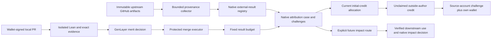

# Research federation pilot

This extends the open-ended v5 protocol; contributors still choose their own
research direction. It targets a **fresh Studio test ledger**. Earlier pilot
balances are not migrated. PNP remains nontransferable research points.

## Status and evidence

The implementation and isolated A/B/C proof reports are in this branch. A local
proof report is not a native acceptance, protected merge, or points award. Until
the release record links finalized transactions, the new federation paths must
be described as locally tested, not live. See `fixtures/federation/README.md` for
the real upstream examples and `docs/JUDGING-BENCHMARK.md` for the separate
evaluation experiment.

The source is `brilliant-hq/pequalnp-proofs` at an immutable commit. Its Lean and
Mathlib versions already match ours. We claim no toolchain migration work.

| Case | What it demonstrates | What it does not establish |
| --- | --- | --- |
| A, L_gct_126 | Direct reuse of an existing formalization | A new discovery or entitlement to points |
| B, L_meta_253 | A verified bridge from graph predicates to our CNF representation | Novelty of the underlying graph fact |
| C, L_meta_727 | A forced-variable consequence and clause reduction using B | A solution to P vs NP or a complexity lower bound |

The upstream PR author is evidence of who submitted the formalization.
Original mathematical discovery remains unknown unless separately supported.
Apache-2.0 source, notices, modifications, commit and blob hashes are retained.

## Architecture and trust



The verifier admits immutable documentary associations, not merit or allocation.
The GitHub adapter bounds bytes and requests, checks Git blob SHA-1 plus content
SHA-256, and binds the changed file to its merged source PR and exact head.
The pilot accepts newly added files from human-type GitHub user accounts, not
modified files, bots, arbitrary repository snapshots or non-GitHub papers.
Source registration awards **zero** points and never grants a local proof badge.
The native registry records an exact statement excerpt; broader source bytes and
license evidence remain in the public packet. This is a trusted evidence-admission
boundary, not a permissionless global literature oracle.

Lean verifies the exact local statement, pinned definitions, permitted axioms and
proof use. GenLayer separately judges marginal value. Repository administrators
still control GitHub, protected workflows and the verifier/executor roles.
Validator agreement is neither proof of global novelty nor expert ground truth.

## Credit and corrections

Formal accepted results retain the existing fixed-budget initial/reserve split.
Research notes retain their capped awards. An external source, identity, account
or dependency count never creates an extra award budget.

After the target's reserve is settled, an attribution case can redistribute
`initial_paid + reserve_returned`. It cannot enlarge that pool, change the original
merit verdict, revoke acceptance, or rewrite previously settled impact. Native
history keeps the original award and every correction. Current account and wallet
balances reflect the correction; earned-history counters are labeled separately.

Consensus approves two distinct ten-band vectors: the existing initial-credit
split and the recipients of **future** incoming impact. Exact integer allocation
uses deterministic remainder handling. Outside shares remain unclaimed until
their source account is authenticated. The integrator cannot select their wallet.

Impact review still evaluates actual direct proof use and mathematical significance.
It binds each upstream attribution revision and route hash. A later correction
blocks a stale settlement. `reconcile_impact_routes` updates recipient commitments
without another merit judgment, preserves the original mathematical bands, and
opens a fresh challenge window. Settlement then binds the exact routing revision
and commitment hash. There are no recursive awards or reference-count rewards.

Two substantive application challenges are available per attribution case.
This pilot can correct the allocation among sources the target already declares.
It cannot yet admit a newly discovered source that a submitter concealed or omitted.
That broader attribution-dispute path requires a separate evidence-linkage policy;
the A/B/C experiment does not demonstrate general plagiarism detection.
Begun/failed/undetermined consensus attempts remain in native state and durable
transaction journals. They are not invitations to create another favorable draw.
New deployments give each admitted review round a one-hour deadline, starting
at admission (and again on a substantive challenge). Begin/resume never extends
it. Anyone can call `expire_attribution(case, round, attestationHash)` after that
deadline while the round remains verified/challenged. A completed provisional
verdict instead follows its normal challenge/settlement window. Expiry preserves
all balances, budgets, attribution revisions, settled route hashes and history;
it discards no journals and applies no prior provisional verdict. Routing resumes
using the last settled allocation. This is a policy choice that favors the
existing allocation until a future protocol policy can reopen the dispute.
The terminal case pointer remains an admission fence for that target/revision,
including alternative source sets. Expiry never authorizes another model draw.
The old deployed contract has no such deadline or expiry method. Author
claim requests also have a 512-record pilot capacity without expired-slot
reclamation. These are test-deployment limits, not production spam resistance.

### Attribution consensus

The leader proposes two separately justified, fixed-pool allocations. Validators
first enforce the exact schema, eligible subjects and total-ten conservation,
then independently audit the proposal against the same evidence. They must
explicitly support both complete vectors (or the rejection), cite the affected
sources and any latest challenge, and reject unsupported or excessive shares.
They do not generate new percentages and require exact equality. The local
`contributor` role is already authenticated; a source account identifies a
qualified formal contributor, not necessarily the original discoverer. All
claims and model reasons remain untrusted evidence. Substantive disagreements
can still fail consensus; this is not a guarantee of a favorable allocation.

## Identity claims

The source author submits `request_author_claim` from their own wallet. Its public
challenge binds chain, contract, policy, numeric GitHub account ID, receiving
wallet, nonce and expiry. They post the **exact** challenge as an unedited comment
on an associated source PR, using the source account. Validators retrieve the
comment independently, check its numeric author and PR association, and recheck
it at settlement. A copied challenge from another account fails. Private keys
remain local. Account control does not establish real-world identity, discovery,
or priority.

We cannot demonstrate an outside researcher's wallet claim by acting as that
researcher. Real outside shares stay unclaimed until they participate. Any own-
account control trial must be identified as a separate controlled pilot.

## Reproduction and operation

Run from the reviewed, clean protocol checkout and the matching problem config:

```sh
npm ci --ignore-scripts
npm test
npm run build
bash github/build-full-lean.sh
# The fixtures README contains the exact isolated A/B/C verification commands.
node scripts/manage-federation.mjs register /trusted/problem source.json /outside/repo/journals
node scripts/manage-federation.mjs attribution /trusted/problem CASE_ID /outside/repo/journals
```

These commands preview by default. `--send` uses the dedicated enrolled verifier
and executor roles through `VERIFIER_SIGNING_KEY`/`EXECUTOR_SIGNING_KEY`. Source
registration takes exactly:

```json
{
  "repository": "owner/repo",
  "pr": 1,
  "commit": "FULL_40_CHARACTER_COMMIT",
  "path": "path/to/Source.lean",
  "theorem": "Source.theoremName",
  "statement": "EXACT_CONTIGUOUS_SOURCE_EXCERPT",
  "origin": "formalization",
  "attributionBasis": "Document exactly what the source PR establishes and what remains unknown."
}
```

The operator does not supply an author ID, receiving wallet, allocation, or arbitrary
fetch URL. The collector resolves source identity from GitHub. Preserve the returned
packet and journal. Reusing the same journal verifies the original receipt;
ambiguous broadcasts are not blindly repeated.

### Resuming attribution without another judgment

Serialize federation operations for each contract and preserve the original
durable journals. For a verified or challenged case whose native `started_round`
already equals its current `round`, both begin and review are recovery-only.
The worker can recheck the recorded transaction hash or recover one exact call
from native history; it cannot broadcast either call when that evidence is
missing. A runtime upgrade can select a different journal filename, but it does
not reset the native started-round fence or authorize another judgment.

An invocation that observes an unstarted round can submit its first review only
after it actually broadcasts begin, durably saves that hash and verifies the
finalized receipt. Recovering a prior begin never permits a fresh review, even
when the first state read preceded that begin's finality. A substantive challenge
advances the native round and receives distinct journal stages. If the worker
crashes after begin is finalized but before the review intent is durably saved,
resuming fails closed unless the original review can be recovered and verified.
This deliberately leaves even a never-submitted
review unfinished rather than treating absent history as permission to send it.

The worker's recovery fence remains necessary: the contract cannot persist an
attempt marker inside a rolled-back consensus transaction. Serialization and
exact-call recovery remain required. On new deployments, after the native review
deadline the worker expires the case deterministically instead of recovering or
resubmitting a judgment. The immutable older deployment still has no exit.
Preserve terminal failures; do not bypass the journal or rerun a case to obtain
a favorable outcome.

### Public-source access and HTTP failures

The operator passes its supplied `GITHUB_TOKEN` to the public-source collector.
In Actions this is the existing ephemeral workflow credential, also used by the
separate evidence-journal client; no new secret or personal token is needed.
It is sent only to the collector's constructed `https://api.github.com/repos/…`
GET endpoints, with redirects forbidden. The repository must still be public,
and all exact PR, commit, source, ancestry, license and byte checks remain in force.
Authentication does not change source hashes or authorize private source admission.

The [complete B-source diagnostic](https://github.com/MuncleUscles/p-vs-np/actions/runs/45302208353)
collected all required public endpoints successfully with the repository workflow
token: 11 requests and source hash
`1b2122f52e9b588d48a8c93a4445a550bfeb3a20d7dd0abc78c272f630f5b450`.
Anonymous collection in that same diagnostic returned the identical hash in
11 requests. This establishes the current pilot credential's access to those
public endpoints, not universal access to other repositories. Earlier anonymous
HTTP 403 failures on other runners do not by themselves establish a rate-limit
or permission cause.

If `GITHUB_TOKEN` is absent, the collector can read anonymously under GitHub's
[public API rate limits](https://docs.github.com/en/rest/using-the-rest-api/rate-limits-for-the-rest-api).
A supplied but malformed credential fails before any request. The operator does
not discover `GH_TOKEN`, invoke a credential manager, request a personal token,
retry transport failures, or switch to anonymous reads after an authenticated
failure. A rate-limit, permission, transport or source-validation failure stops
collection before its dependent native write. Existing transaction journals and
native outcomes remain preserved; changing credentials is not a new merit attempt.

HTTP failures report only a bounded numeric status and the internally constructed
API path, for example `HTTP 403 for /repos/owner/repo/pulls/2; complete HTTP 200
response required`. They never include response bodies, status text, headers,
server-supplied URLs or credentials. A status alone does not establish the cause:
access scope, rate limits, missing resources and transient failures must be
distinguished from the observed endpoint and surrounding evidence.

### Exact JSON for workflow dispatch

`register` and `verify-author` read normalized JSON both from local files and
from the **Research federation** workflow's `payload` input. After removing
trailing whitespace, that text must equal `JSON.stringify(request, null, 2)`:
two-space indentation, ordinary newlines and literal Unicode where JavaScript
emits it. Compact JSON and unnecessarily escaped Unicode are rejected before
any transaction. Create the request from a reviewed object with that exact
serializer; keep the displayed JSON above in the same format. This check also
rejects duplicate keys. Do not parse and rewrite an unreviewed request merely
to bypass the check.

For example, validate an existing `source.json` and prepare a dispatch body
without changing its inner payload:

```sh
node --input-type=module - source.json /private/tmp/federation-dispatch.json <<'JS'
import fs from 'node:fs';
import {parseProblemJSON} from './src/problem.mjs';
const [source, output]=process.argv.slice(2);
const bytes=fs.readFileSync(source);
parseProblemJSON(bytes);
const dispatch={ref:'main',inputs:{operation:'register',payload:bytes.toString('utf8').trimEnd()}};
fs.writeFileSync(output,JSON.stringify(dispatch,null,2)+'\n',{flag:'wx'});
JS
```

This only prepares the body; it does not dispatch the workflow. Send its `payload`
as a string, preserving embedded newlines and Unicode. For `verify-author`, use
that operation and its three-field request below. `attribution`,
`reconcile-impact` and `settle-author` instead take the exact native ID as plain
text, without JSON quotes.

Contributor operations use `scripts/federation-agent.mjs TRUSTED_PROBLEM
PUBLIC_REQUEST.json JOURNAL.json [--send]` and `CONTRIBUTOR_KEY_FILE`, an owner-only
file outside repositories. A request has exactly `method` and `args`. Supported
methods are `request_attribution(target, expectedRevision, evidenceJSON)`,
`challenge_attribution(caseId, evidenceText)` and
`request_author_claim("github:NUMERIC_ID", nonceHex64, expiryUnixSeconds)`.
The attribution evidence has exactly `claim` and `sources`, each source being
`{id, source_hash}`. Those registered source URLs must match the target's declared
provenance. This is an audit workflow; contributor-supplied programs are never run.

`manage-federation.mjs verify-author` takes a JSON file with `claim`,
`external_result`, and `comment_id`. `settle-author` takes the native claim ID.
Both use the original exact intent and retain failed receipts. Challenge-window
waiting is explicit; a waiting result does not mean settlement succeeded.
